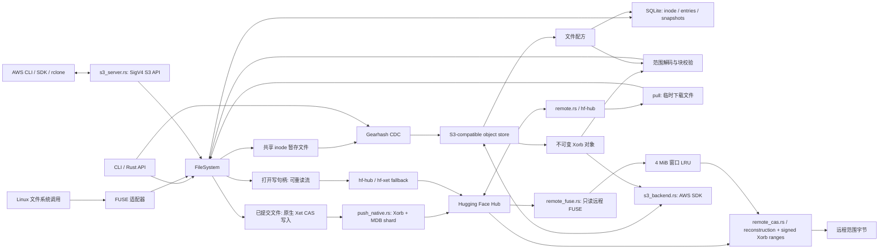

# XetFS 0.1 结构与存储约定

## 从 Xet 到文件系统

[Xet](https://huggingface.co/docs/hub/en/xet/index)提供面向大文件的内容寻址、分块去重和重建机制。XetFS 在这些机制上增加 inode、目录树、文件句柄和内核文件系统接口。



## 模块

| 模块 | 责任 |
| --- | --- |
| `chunker.rs` | `Read` 输入的流式 CDC，边界独立于读缓冲区大小 |
| `hash.rs` | Xet 块、Xorb、文件和 term verification 哈希；API 十六进制字序 |
| `xorb.rs` | v0 块头、三种压缩类型、解码大小限制 |
| `repository.rs` | CAS 对象、块索引、不可变文件配方、事务、快照、GC、fsck |
| `filesystem.rs` | 目录与 inode 语义、共享写暂存、句柄和 lookup 引用生命周期 |
| `remote.rs` | Hub revision 枚举、官方客户端拉取、写入 fallback 与本地/远端路径映射 |
| `remote/push_native.rs` | 已提交文件的 Hub preupload、Xet write token、原始 Xorb CAS 上传、MDB shard 编码和 Hub LFS commit |
| `remote_cas.rs` | Hub 文件元数据、读 token、v1/v2 CAS reconstruction、有界并发 signed multi-range Xorb 下载与范围重建，以及 Hub API URL/token 辅助 |
| `s3_server.rs` | SigV4 S3 网关；将桶映射为根目录子目录，将对象键编码到保留子树；支持对象 CRUD、Range、ListObjectsV2 和 multipart 上传 |
| `s3_backend.rs` | AWS SDK S3 Xorb 对象后端、读穿本地缓存、校验回填及 S3 后端配置；所有凭证由 AWS SDK 凭证链提供 |
| `remote_fuse.rs` | Linux 只读远程挂载：revision 文件树、Xet 文件 inode、固定窗口 LRU 与按需 CAS 范围读取 |
| `fuse.rs` | Linux FUSE 回调、属性映射、稳定目录句柄与内核权限选项 |
| `main.rs` | 管理、导入导出、范围读取、哈希、远程同步和挂载命令 |

## 算法对应关系

CDC 使用 [Xet chunking](https://huggingface.co/docs/xet/en/chunking)的固定 Gear 表和 mask `0xffff000000000000`。每个 chunk 重新开始 rolling hash；最后一个块允许短于最小值。标量实现优先保证跨平台一致性。

[哈希](https://huggingface.co/docs/xet/en/hashing)使用协议中的固定 data/internal/verification keys。Merkle 分组合并遵循固定版本参考代码的内容相关切点，文件根再使用全零 key 计算 keyed BLAKE3。空文件采用参考实现的零哈希。外部字符串按四个 little-endian u64 输出，区别于直接把 32 字节逐字节 hex 编码。

Xorb 使用 [v0 块记录格式](https://huggingface.co/docs/xet/en/xorb)：版本 1 字节、压缩长度 3 字节、压缩类型 1 字节、原始长度 3 字节，长度均 little-endian。每块尝试 raw、LZ4 frame、BG4 + LZ4 并选择最小结果。序列化对象总长限制为 64 MiB。

本地对象是无 footer 的块流。`inspect-xorb` 还接受官方固定样本实际包含的 `XETB` 末尾标记，且要求标记后立即 EOF；不把该观察扩展为对所有官方对象 footer 的支持。native 写入保留本地块记录字节，并单独编码官方 MDB file/xorb metadata shard；chunk range 使用解压后的字节偏移，CAS Xorb 请求按对象 hash 幂等重试。生成的 shard 由固定版本的官方 Rust 结构解析器验证，并已在 Hugging Face Hub 完成上传与双客户端下载回读。

`remote pull` 由官方 `hf-hub` Rust 客户端读取 Hub revision。已提交文件的 `remote push` 使用 `remote/push_native.rs`：查询 Hub preupload 模式，对 SHA-256/长度执行 Git LFS batch 协商并确认 Xet transfer，取得短期 Xet write token，验证不可变本地 Xorb，通过 CAS HEAD 跳过已存在对象、仅上传缺失对象，并将 CAS 返回的实际序列化长度写入复用 Xorb 的 shard 元数据，之后生成 MDB file/xorb sections 与 verification/SHA-256 metadata、注册 shard，再通过 Hub NDJSON commit 写入 LFS pointer。shard 中的 SHA-256 扩展按 Xet DataHash 的四个小端 u64 字布局编码；Git LFS OID 保持标准 SHA-256 字节序。HEAD 在旧端点被拒绝或不支持时会回退到 POST。CAS 对象上传最多尝试四次，仅对网络连接/超时与 5xx/408/429 重试；服务端返回的错误体片段和请求 ID 用于定位失败。push 报告记录 worker、Xorb 上传/跳过数量及 Xorb 阶段耗时。打开写句柄的文件与大于 inline 上限的非 Xet 文件保留官方 `hf-hub`/`hf-xet` 流式路径。小型 inline 文件通过 Hub 的 base64 commit 操作提交。`remote cat` 的 Xorb 数据面由 `remote_cas.rs` 独立实现：经 Hub metadata 取得 Xet file id，通过 Hub 的 xet-read-token API 获取短期 CAS token，查询 v2 reconstruction（404/501 回退 v1），按照签名 URL 给出的精确 HTTP Range 请求并行读取 Xorb 记录，再通过本地 Xorb 解码器按 term 次序重建。并发数可通过 `--workers` 设为 1–64，默认 1；响应体、重建描述和范围总量均有上限。完整文件读取以本地 Xet file hash 校验，部分范围以 reconstruction 长度、range 边界和解码记录长度校验。短期 token 和签名 URL 仅驻留内存。

Linux `remote mount` 在启动时从 Hub `list_tree` 固定一个文件树视图，只纳入带 Xet file id 的常规文件；目录按需由路径隐式构造。读取按文件偏移切成 4 MiB 对齐窗口，复用同一个 CAS HTTP client 与未过期 token，并通过可配置大小的 LRU 保留最近窗口。挂载提供只读权限；单个部分窗口读取验证相应 Xorb/chunk，但整个文件根哈希只在读全文件时可计算验证。分支后续更新不会改变当前挂载的目录树或已列出的文件 id。

已提交 Xet 文件的 native 写入由 XetFS 完成 chunk/Xorb 编码、MDB shard 注册和 Git LFS pointer commit；dirty/open 内容仍交给官方 `hf-xet` 流式路径。Hub shard 与 XetFS 本地仓库格式保持独立，本地 SQLite 不会上传。

## 仓库格式

```text
repo/
  LOCK                    进程生命周期的排他 advisory lock
  metadata.sqlite         schema user_version = 1
  metadata.sqlite-wal     SQLite 自行管理
  metadata.sqlite-shm     SQLite 自行管理
  objects/<xet-hash>.xorb  已提交或待回收的不可变数据对象
  tmp/                    暂存文件与待发布对象
```

`schema.sql` 定义格式。`xorbs` 和 `xorb_chunks` 记录物理对象的完整目录；`chunks` 把唯一块哈希映射到一个物理位置。普通 GC 可删除块索引而保留部分使用的对象，完整物理目录仍允许 fsck 校验对象中所有记录。

`contents` 保存不可变版本的 Xet 文件哈希和长度。`file_chunks` 保存顺序、逻辑偏移、长度与块哈希。配方独立于块的当前物理位置，压实只调整块索引。`reconstruction`/`manifest` 将连续的物理块合并成 `(xorb, [chunk_start, chunk_end))` terms，附带逻辑偏移、长度和 verification hash。

`inodes` 保存 inode 属性及内容配方 ID；`entries` 使用 `(parent_inode, raw_name_bytes)` 作为键。同一 inode 可有多个文件目录项；目录不允许硬链接。根 inode 为 1，其余 inode 使用 SQLite AUTOINCREMENT。

配置 S3 后端时，`s3-backend.json` 只保存 bucket、region、prefix、endpoint 和 path-style 选项，不包含密钥。远端对象键为 `<prefix>/objects/<xorb-hash>.xorb`。AWS SDK 凭证在进程启动时从环境变量、profile 或运行环境凭证源取得。S3 是 Xorb 内容对象的远端副本和回源来源；SQLite namespace、WAL、进程锁和缓存仍在本地，因此它不提供多主元数据、跨机锁或共享仓库语义。

快照复制 inode 和目录项元数据，共享不可变配方。它不是独立的数据备份，底层对象仍属于同一仓库。

## 写入和持久化

导入和 fsync 的顺序为：

1. CDC 分块并查询仓库级去重索引。
2. 仅将未知块编码进新 Xorb。
3. 写临时对象并 `sync_all`，以 no-clobber 方式发布，再 fsync 对象目录。
4. 提交块索引与不可变配方的 SQLite 事务。
5. 提交 inode 对新配方的引用、长度及时间戳。

启用 S3 后，第 3 步还会先完成同名 Xorb 的 S3 `PutObject`，然后才提交 SQLite 索引。这样远端对象不会早于本地对象成为配方引用，但两边无法组成一个分布式事务；崩溃或本地事务失败可能留下未引用的 S3 Xorb，由 GC 列出配置前缀并清理。读取时先查本地对象缓存；缓存文件不存在则下载远端对象，校验完整 Xorb 编码与 Xorb 哈希后原子写回本地 `objects/`。`fsck` 也会在验证前补回缺失的缓存对象。

旧 inode 配方在新内容完成提交之前始终有效。导入读错误或未完成的事务不会让旧文件指向半个新对象。

| 中断位置 | 恢复结果 |
| --- | --- |
| 对象仍在 tmp | 下次独占打开仓库时清理暂存 |
| 对象已发布、索引事务未提交 | 对象成为孤儿，GC 清理 |
| 新配方已提交、inode 尚未切换 | 旧文件可读，新配方等候 GC |
| inode 事务已提交 | 新文件配方完整且对象已持久化 |

FUSE 的同一 inode 共享一个磁盘暂存文件。任意句柄读写都观察这一份内容；append 在串行回调中选择当前长度。flush/fsync 提交暂存内容；最后 release 也尝试提交。`O_SYNC`/`O_DSYNC` 写入立即提交。进程被强制终止时未提交的暂存写入可能丢失，已成功 fsync 的内容保存在 CAS 和 SQLite 中。

打开后删除的文件保留 inode，直到文件句柄和内核 lookup 引用均释放。恢复启动会删除无目录项的遗留 inode。重命名和覆盖在单个 namespace 事务中完成，打开的旧目标句柄仍可访问旧 inode。

## 读取、维护与代价

范围读取先通过 `(content, offset)` 索引找到起始块，再遍历交叠的块；仅读取相应的 Xorb 记录。每块解压后检查长度与 keyed BLAKE3 哈希，再返回请求范围。对不可变文件的读取不会把整个 Xorb 或整个文件加载入内存。

GC 的根包括当前 inode 和快照 inode。删除配方与块索引后，完全空闲的 Xorb 可移除；压实将所有存活块写入新对象并提交新位置，最后删除不再引用的旧对象。任何中断只留下可回收对象。执行 GC 时不能持有打开的文件句柄。

`fsck` 检查 SQLite 完整性、外键、物理 Xorb 内容与哈希、块索引、文件配方偏移及根哈希、inode 长度与主要 namespace/snapshot 约束。它检测问题并返回错误，不自动修复数据。

`remote pull` 固定读取请求的 Hub revision，将匹配的目录树下载到临时目录，检查文件长度后逐项导入本地文件系统。`remote push` 先建立稳定文件清单。对已提交 Xet 内容，native 路径从现有配方重建 shard，不重新扫描以生成 chunks、不复制整文件；它会顺序计算 Git LFS 所需 SHA-256。对正在写入的内容，官方客户端从可重读的暂存文件描述符读数据。push 是文件 upsert，不镜像删除；远程与本地的 revision 不额外记录在 SQLite 中。

`remote cat` 用 Hub file metadata 找到目标文件哈希后，直接按字节范围请求 Xet CAS reconstruction 和签名 Xorb ranges；每次输出最多 64 MiB，适用于模型权重头部探测、索引读取和远程抽样。该命令输出原始字节，不修改本地 CAS。

数据缓冲上界为一个至多 64 MiB 的编码对象及少量块；导入的配方和已见块集合占用 O(块数) 内存。当前随机写入的提交仍需扫描整个暂存文件，且 FUSE 使用直接 I/O 和串行回调。native push 已实现有界并行 CAS Xorb 上传与远端 HEAD 去重；后续性能方向包括脏区附近 CDC 重同步、块缓存、批量小文件打包与并行编码。
